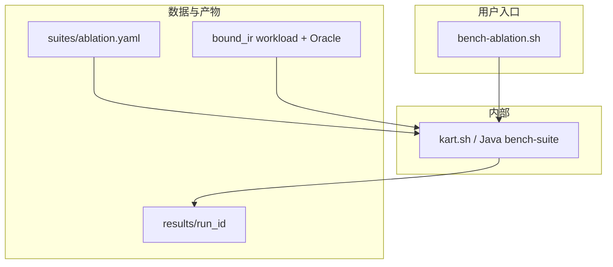

# KART 消融实验规范（Ablation）

- 版本：v0.1，2026-09-25
- 状态：规范已锁定；规划侧 leave-one-out 开关与 `experiments/suites/ablation.yaml` 已按本文落地。正式主表仍须 HBase 冷跑与 Oracle 门禁，不得以「脚本能启动」代替。
- 上游：`spec/design.md` §8–10、`spec/IMPLEMENTATION_PLAN.md` §19.2、`docs/environment-lock.md`
- 正交规范：[`spec/comparative_experiment.md`](comparative_experiment.md)（外部方法 / HBase 基线横比；**不**在消融中复用为臂）
- 数据与用例：与对比实验 E2/E3 同一 `experiments/workloads/bound_ir_cmp_v3.json`（当前冻结 20 条 rewrite≥10% 切片）及对应 Oracle

---

## 1. 目标与假设

### 1.1 目标

KART 是 HBase 上基于 LLM 的轨迹查询整系统（NL→IR、dual 优化、校验与执行输出）。本文主表只消融其**查询优化层**。

在**同一金标 BoundIR、同一 T-Drive 快照与同一 HBase 环境**下，对 Full KART 的 dual 优化（CBO 地板 + 离线准入规则 + 在线残差 LLM）做 leave-one-out：

1. 去掉 LLM 层（离线规则与/或在线残差）对 e2e 延迟与正确性的影响
2. 去掉 Fast Cost / Final Cost 对 e2e 延迟的影响（CBO 选优仍走同一 rewrite 路径）
3. （风险对照）关掉 CoverageCheck 对正确性的影响

### 1.2 假设与限制

- 语义：`OBSERVED_POINT`；时间半开区间；空间闭矩形；相似度量按 `design.md`
- 存储：单节点伪分布式 HBase（见 `docs/environment-lock.md`）；**结论只报相对优劣，不外推多 RegionServer**
- Manifest：实验期间固定（默认 `tdrive_v1_ready`），写入每次 `meta.json`
- **仅消融 KART 自身组件**；DIN / SAG / Bao / LLMOpt / fullscan / rbo / cbo **不进消融臂**（见 §2）
- 主消融从金标 BoundIR 起算；**NL→IR 不进主表**（可选附录，非本文主 RQ）
- 参数扫描（beam、budget、时间桶、Z 层级 L、chunk 等）归独立 param 规范 / `bench-param.sh`，**不混入消融主表**

### 1.3 与对比实验的关系（正交）

| 规范 | 回答的问题 | 臂来源 |
|---|---|---|
| 对比实验 | KART **整系统**相对外部方法 / HBase 基线如何 | 外部移植臂 + fullscan/rbo/cbo/`kart`（系统在该层的入口） |
| **消融实验（本文）** | KART **内部**哪块贡献了什么 | 相对 Full KART 的单因素变体 |

二者共享 workload / Oracle / 计时边界约定，但**结果表不得混写**；不得用消融臂冒充外部对比，也不得把对比臂塞进消融主表。

### 1.4 数据流约定

```text
输入：金标 BoundIR（与对比实验 E2/E3 相同）
各臂：相对 Full KART 只改一个因素 → SafePlan → 执行 → 结果
计时：t_plan（生成开始→选出最终 SafePlan）+ t_exec；t_e2e = t_plan + t_exec
```

- **不计** NL / LLM→IR 时间（与对比实验 E3 边界一致）
- 主阶段为 **e2e**（含 plan/exec 分解）；可选 plan-only 行聚焦 `t_plan`，臂集合相同，不另立公平性体系

---

## 2. 明确非臂（不进入消融）

| 名称 | 原因 |
|---|---|
| DIN-SQL / SAG / Bao / LLMOpt | 属对比实验外部移植臂 |
| `fullscan` / `rbo` / `cbo` | 属对比实验 E3 基线；消融用 `cbo_only` 表达「仅 CBO 地板」，不把对比臂 `cbo` 列入消融表 |
| NL 解析变体（澄清开关、schema 重试等） | 论文重心为规划层；解析消融不进主表 |
| 参数网格点（如 `beam_width=1`） | 属 param 实验，不是 leave-one-out 组件消融 |

Related Work / 对比实验可引用上述工作；**不得**作为本文可运行消融臂。

---

## 3. 整体架构与脚本入口

### 3.1 架构



### 3.2 用户可见入口

| # | 脚本 | 作用 |
|---|---|---|
| 1 | `scripts/bench-ablation.sh` | 消融套件：Full 基线 + 各 leave-one-out 因子 |

脚本内部调用 `kart.sh` / `bench-suite`；规范**只承诺**上述入口（与对比实验的 `bench-parse/plan/e2e/all` 并列，互不替代）。

### 3.3 参数（最小集）

| 参数 | 含义 | 默认 |
|---|---|---|
| `--run-id <id>` | 结果目录名 | 必填或自动时间戳 |
| `--suite <path>` | 套件 YAML | `experiments/suites/ablation.yaml` |
| `--factor <list\|all>` | 参加因子。安全因子会自动带上 `full` 以便配对 delta；仅 `no_coverage` 等风险筛选不自动配对 | 已启用且非 unsafe 的因子 |
| `--no-pair-full` | 关闭安全 `--factor` 的自动 Full 配对（单臂诊断） | 关闭 |
| `--workload <path>` | 覆盖套件内 workload | 套件默认 |
| `--cache cold\|warm` | 缓存协议 | `cold`（主表） |
| `--allow-unsafe` | 允许跑 `unsafe: true` 因子 | 关闭 |

### 3.4 调用示例

```bash
cd /home/jaytang/projects/llm-kv   # 或文档约定的 WSL 工作目录
./scripts/kart.sh up && ./scripts/kart.sh rebuild
./scripts/bench-ablation.sh --run-id abl1
./scripts/bench-ablation.sh --run-id abl1-risk --allow-unsafe --factor no_coverage
```

### 3.5 结果目录

```text
experiments/results/<run_id>/
  meta.json
  ablation.jsonl    # 每行一条 (query_id, factor/arm, ...)；亦可复用 e2e.jsonl 并带 factor 字段
  summary.md
```

---

## 4. Full 基线与消融臂（leave-one-out）

### 4.1 Full KART（基线）

主表从金标 BoundIR 起，对应整系统的**优化 + 校验 + 执行输出**（NL→IR 不进本表）。

| 字段 | 取值 |
|---|---|
| 臂 / 线名 | `full`（suite 中 `base_arm: kart` = `LlmRewriteArm`，**不得**以 `rule` 为 Full） |
| 策略 | Dual rewrite（`dual_rewrite_v43`：CBO + 离线 admitted 规则 + 至多一次在线残差 LLM；无命中保留 CBO） |
| 验证 | Structure + Semantic + **Coverage** + PhysicalSafety |
| 代价 | Fast Cost（搜索引导）+ Final Cost（SafePlan 上 `estimated_ms` 最小） |
| 索引族 | 允许联合索引（INTERSECT：`P_TZ` / `P_TH` / …）及单索引、`P_FULL` |
| 系数 | `config/planner.yaml` 中冻结的 **已校准** 系数（`calibrated=true`） |
| 预算 | 与对比实验 E2/E3 相同的 SearchBudget 上限（写入 meta） |

### 4.2 主表臂

相对 `full` **每次只改一列「相对变化」**。

| `--factor` / 臂 ID | 相对 Full | 操作化 | 主指标 |
|---|---|---|---|
| `full` | — | `kart` 默认 `action_mode=dual-rules` | 参照 |
| `cbo_only` | −离线规则 −在线残差 | 同一 `LlmRewriteArm` / 同一 CBO 搜索后跳过 rewrite（`action_mode=cbo_only`）；**不**换成 `RulePolicy` | e2e + Oracle |
| `no_online_llm` | −在线残差 | `action_mode=dual-offline-rules`：CBO + 离线规则，不调在线 LLM | e2e + Oracle |
| `no_fast_cost` | −搜索中 Fast Cost | `use_fast_cost=false`；rewrite 路径不变 | e2e |
| `no_final_cost` | −Final Cost 选优 | `final_select=plan_id`；rewrite 路径不变 | e2e |
| `no_coverage` | −CoverageCheck | 见 §4.3；**仅风险表** | Oracle |

说明：

- `cbo_only` 与 `no_online_llm` 都留在 `kart` 臂上，只改 `action_mode`，避免整臂替换成 Native policy。
- `no_fast_cost` / `no_final_cost` 只改 CBO 的 `PlannerConfig`，不改 Dual rewrite 的 G1/规则逻辑。
- 旧因子 `no_llm_rule` / `llm_direct` / `single_index` / `uncalibrated` **不进本主表**。

### 4.3 风险对照臂（不进可部署主结论）

| 臂 ID | 相对 Full | 操作化 | 表位置 |
|---|---|---|---|
| `no_coverage` | −CoverageCheck | Structure / Semantic / PhysicalSafety **仍开启**；仅关闭 Coverage；标记 `unsafe: true` | **仅风险表** |

- 跑此臂必须显式 `--allow-unsafe`。
- 若出现相对 Oracle 的漏查 / 假阴性，用于论证覆盖验证必要性；**不得**称为可部署基线，**不得**与主表加速比混排为「更优系统」。
- 对齐 `IMPLEMENTATION_PLAN.md` §19.2：「去掉验证器的版本若产生漏查，只能作为错误风险对照」。

### 4.4 实现对照（语义锁定；缺口不豁免公平性）

| 因子 | 现有能力 | 规范要求 |
|---|---|---|
| `full` / `cbo_only` / `no_online_llm` | `LlmRewriteArm` + `action_mode` overlay（经 `BenchContext.extras`） | 已落地；因子不得用 `policy:` 整臂替换 |
| `no_fast_cost` | `PlannerConfig.use_fast_cost` | 已落地：关闭 CBO 搜索按 Fast Cost 排序/停滞剪枝 |
| `no_final_cost` | `PlannerConfig.final_select=plan_id` | 已落地：SafePlan 按 `plan_id` 字典序选取 |
| `no_coverage` | `PlannerConfig.skip_coverage_check` | 已落地；须 `--allow-unsafe` |

未实现的因子不得用「近似替代」（例如用缩 beam 冒充 `no_fast_cost`）填主表；实现完成并写入 meta 后方可作为正式结论。

---

## 5. Workload 与 Oracle

### 5.1 文件约定

| 文件 | 用途 |
|---|---|
| `experiments/workloads/bound_ir_cmp_v3.json` | 金标 BoundIR（与对比实验 E2/E3 **同一冻结版本**，当前 20 条） |
| `experiments/workloads/bound_ir_cmp_v3.oracle.json` | FullScan Oracle 缓存 |
| `experiments/workloads/bound_ir_v1.json` | 历史 BoundIR-65；仅回归 / oracle-diff，**不是**消融主表 |

正式实验前冻结版本号与校验和写入 `meta.json`。Smoke（如 `tdrive_smoke.json`）仅用于连通性，**不得**单独作为论文主表。

### 5.2 分层

与对比实验一致，至少覆盖：

- 谓词：仅 T / 仅 Z / 仅 H / TZ / 组合 / Top-K
- 选择率：小窗 / 大窗
- 含 CBO 易错 / rewrite 有机会改写的样例，以便 `cbo_only` 与代价相关臂可解释

### 5.3 Oracle

- 真值：FullScan + ExactFilter（与 `design.md` 语义一致）
- Top-K：有序列表相等（含 tie_breaker）
- 失败（超时、`RESOURCE_EXHAUSTED`、非法计划、`NO_SAFE_PLAN`）：单独计数；**主延迟在成功子集上计算**，并披露失败率

### 5.4 JSONL 行字段（最小集）

`ablation.jsonl`（或等价 e2e 行）每行至少：

`run_id, query_id, factor, arm, unsafe, ok_oracle, t_e2e_ms, t_plan_ms, t_exec_ms, plan_id, n_candidates, n_validation_reject, llm_calls, tokens_in, tokens_out, plan_regret_ms, n_ranges, index_rows, fetch_chunks, bytes, dtw_cells, error, trial`

- `factor`：`full` 或 §4 因子 id
- `arm`：实际 `PlannerMode` / 线名（如 `llm`、`rule`）
- `unsafe`：是否风险臂
- `llm_calls` / `tokens_in` / `tokens_out`：**每行都必须有键**；该臂未调用 LLM 时写 JSON `null`（不得省略键；汇总若把 null 当 0 须显式转换）
- 分层辅助键：`family`、`selectivity`、`metric`、`k`、`empty_boundary`（来自 catalog + BoundIR）
- 消融行另有 `cost_calibrated`（该 cell 实际系数，不是全局 base）
- 重复：每 `(query, factor)` 建议 ≥3，报 P50/P95

---

## 6. 指标

### 6.1 正确性（主）

- 与 Oracle 一致率（`ok_oracle`）
- 合法 SafePlan 产出率；失败原因分布
- 风险臂额外报告漏查 / 假阴性明细

### 6.2 延迟（主）

- `t_plan` / `t_exec` / `t_e2e` 的 P50/P95
- 相对 `full` 的加速比或回退比（成功子集）
- 缓存协议：主表 **cold**；warm 可附录

### 6.3 辅助（解释与规划开销）

- LLM calls / tokens（`full` 可能调用在线残差；`cbo_only` / `no_online_llm` 应为 `null` 或 0）
- `n_candidates`、验证拒绝次数、`plan_regret_ms`（有则报）
- 扫描 ranges、索引行、回表 chunk、bytes、`dtw_cells`

### 6.4 论文用表建议

- **主表**：§4.2 全臂 × 正确率 + `t_e2e`（及 `t_plan`/`t_exec` 分解）
- **风险表**：仅 `no_coverage`（及未来若增加的其它 unsafe 因子）
- 可选短表：将主表结果按「搜索 / 安全 / 代价」三模块聚合叙述（**不另跑实验**，避免与 leave-one-out 因果冲突）

---

## 7. 公平性总则

1. 同一快照、表布局、manifest、执行器、batch / 线程池；禁止一侧隐藏加速（未文档化的预热等）
2. 相对 `full` **单因素**变化；禁止一次关掉多个主表因子后仍称 leave-one-out
3. 调用在线 LLM 的因子（`full`）使用同一 `LLM_BASE_URL` / `LLM_MODEL` / `temperature=0`（或写入 meta 的统一采样设置）
4. SearchBudget 上限与对比实验 E2 一致，写入 meta
5. 代价系数：`full` 与代价消融臂使用冻结已校准文件；**禁止**用测试集实测回灌后再报事前指标
6. 主延迟：成功子集 + 失败率披露
7. 单节点结论不得写成集群结论
8. unsafe 因子默认不跑；正式风险表须 `--allow-unsafe` 且单独披露协议

---

## 8. 风险对照协议（`no_coverage`）

1. 仅关闭 CoverageCheck；其余验证层保持开启，避免「关掉全部验证」与「关掉覆盖」混淆
2. 结果与 Oracle 逐查询比对；漏查必须可复现（保留 plan / physical / validation 报告）
3. 延迟数字若因非法覆盖变「更快」，只能在风险叙述中解释为**错误加速**，不得进入主加速比排序
4. 论文表述必须标明「错误风险对照 / 非可部署配置」

---

## 9. 环境与复现元数据

每次 run 的 `meta.json` 至少包含：

- `experiment_kind`: `"ablation"`
- `manifest_id`、`semantics_version`、`git_commit`（本仓库）
- JDK / HBase client·server / ZK（对齐 `docs/environment-lock.md`）
- `LLM_BASE_URL`、`LLM_MODEL`（无密钥）
- `base_arm` / `factors[]`：每项含 `id`、`arm`、`overrides`、`unsafe`、`cost_calibrated`、`cost_model_version`、`cost_coeffs_path`、`cost_coeffs_sha256`
- 顶层 `cost_calibrated` 仅表示 base `planner.yaml`；逐因子状态以 `factors[]` 为准
- `workload` 路径与校验和、`oracle` 路径、`cache`、`trials`、`formal_workload_complete`
- `search_budget`（`beam_width`、`max_llm_calls`、`max_candidates`、`max_plan_ms` 等）
- `allow_unsafe`
- `cache_protocol.warmup_arm_order_policy`：warm 预热与计时样本使用同一轮换族

工作目录：WSL 内文档约定路径；HBase / `kart.sh up` 就绪后再跑含执行的消融。

---

## 10. 不做项

- 将 DIN / SAG / Bao / LLMOpt / fullscan / rbo / cbo 列为消融臂
- 将 NL 解析时间计入 `t_e2e`，或把解析消融作为本文主表
- 用参数网格（beam/budget/桶宽等）冒充组件消融
- 与 Spider / BIRD / TEND 公开榜数字横比
- 多节点扩展实验
- 把 `no_coverage`（或其它 unsafe）结果写成可部署系统优势
- 以「脚本能启动」代替公平性；因子语义未按 §4 落地前，结果不得进论文主表

---

## 11. 与需求 / 设计 / 实现计划的关系

- `IMPLEMENTATION_PLAN.md` §19.2「必做消融」由本文操作化为 Dual rewrite leave-one-out（`cbo_only` / `no_online_llm` / cost / coverage）
- 计划搜索、验证器、代价模型行为以 `design.md` §8–10 为准；rewrite 语义以 `DualRewritePolicy` 为准
- 对比实验规范定义外部公平横比；本文定义内部因果消融；二者互补，互不替代
- 套件文件 `experiments/suites/ablation.yaml`：`base_arm: kart`（Full Dual rewrite），factors 对齐 §4.2–4.3；`no_coverage` 为 `unsafe`，默认跳过

---

## 12. 实现阶段建议顺序

1. ~~修正 suite：`base_arm=kart`（Dual rewrite），因子对齐 §4~~ 已落地
2. ~~`cbo_only` / `no_online_llm` 经 `action_mode` overlay，不换 Native policy 臂~~ 已落地
3. ~~`no_fast_cost` / `no_final_cost` / `no_coverage`~~ 已落地
4. 与对比实验同一 `bound_ir_cmp_v3`（当前 20 条）跑正式 cold 主表 + 风险表

入口：`scripts/bench-ablation.sh`。因子语义未按 §4 执行的 run 仍不得进论文主表。
